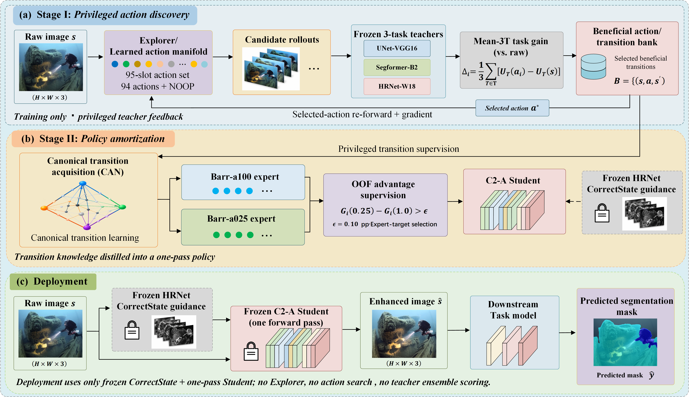

# TEAE: Task-driven Enhancement Action Evolution

**Task-Beneficial Underwater Image Enhancement via Learned Action Manifolds and Policy Amortization**

**Authors:** Shiyao Feng, Jun-Hong Cui, ChunRu Wan, and Gaochao Xu  
**Code and models:** [TEAE v0.1.0 release](https://github.com/FengSY-JLU/TEAE/releases/tag/v0.1.0) — frozen inference, task evaluation, and model checkpoints for non-commercial research/evaluation.

## Overview



*TEAE separates task-beneficial enhancement action discovery from efficient policy amortization. Stage I learns an image-conditioned action repertoire using privileged task feedback. Stage II transfers the discovered behavior into a Student enhancer. Deployment requires only the frozen HRNet CorrectState provider and one C2-A Student enhancement pass: no test-time candidate search, ground-truth supervision, or teacher-ensemble scoring.*

## Highlights

- **Learned action manifold:** A structured, image-conditioned family of enhancement candidates, with an explicit no-op option, is optimized using privileged task feedback during training.
- **Policy amortization:** Canonical-transition acquisition, basin-anchored refinement, and source-routed advantage supervision train the deployable C2-A Student.
- **Fixed inference path:** A frozen five-level HRNet CorrectState pyramid conditions one Student forward pass.
- **Task-centered evaluation:** Protocol-A measures immediate utility with frozen task networks; Protocol-B evaluates separately adapted downstream segmentation models. Their metrics use different aggregation rules.

## Evaluation snapshot: SUIM TEST110

The numbers below describe the stated task models and evaluation protocols, **not** a universal ranking of perceptual image quality.

| Input | Protocol-A Mean-3T mIoU (%) | Protocol-B U-Net-VGG16 mIoU (%) | Protocol-B SegFormer-B2 mIoU (%) |
|---|---:|---:|---:|
| RAW | 73.615 | 66.267 | 72.808 |
| DTI-UIE | 67.835 | 62.922 | 73.269 |
| HSRUIE | 63.265 | 62.281 | 70.487 |
| **TEAE (C2-A)** | **75.596** | **69.289** | **75.746** |

**Protocol-A** uses three frozen segmentation teachers and averages per-image, ground-truth-present-class hard mIoU (including class 0 when present and ignoring label 255). TEAE improves the Mean-3T score by **+1.981 percentage points** over RAW.

**Protocol-B** evaluates separately trained U-Net-VGG16 and SegFormer-B2 E80 segmentation models for the RAW, DTI, HSR, and TEAE domains. Its score is **dataset-global confusion-matrix mIoU**; it must not be compared numerically with Protocol-A mIoU as though they were the same metric.

**Numerical validation:** The released-source evaluation was checked against frozen benchmark references on the 110-source protocol with a declared maximum absolute mIoU tolerance of 0.01 percentage points. This is a numerical-consistency check, not a claim of bitwise-equal confusion matrices or reproduction of the third-party baseline authors' training. See [`metadata/NUMERICAL_REPRODUCIBILITY.md`](metadata/NUMERICAL_REPRODUCIBILITY.md).

## Repository scope

This public repository provides TEAE's **frozen Student/CorrectState inference**, Protocol-A and Protocol-B evaluation interfaces, benchmark reference evidence, and baseline-comparison instructions. Its focus is **reproducible inference and assessment** rather than full training-pipeline reproduction. Dataset images and labels are supplied by users; external enhancement baselines are obtained from their original authors.

## Installation and model assets

A compatible PyTorch/CUDA environment is required. The frozen experiments used PyTorch `2.7.1+cu118`; `requirements.txt` lists Python dependencies but is not an exact environment lockfile.

```bash
python -m pip install -r requirements.txt
```

Download the published **model archive** and **`SHA256SUMS.txt`** from the [v0.1.0 Release page](https://github.com/FengSY-JLU/TEAE/releases/tag/v0.1.0):

- Actual downloadable archive name: `TEAE_MODEL_RELEASE_v0.1.0_LICENSED_CANDIDATE.tar.gz`
- Archive size: `1,002,060,676` bytes
- SHA256: `2a2bbb2152b5e86d7f5275d83292bffc00f675a47851597f9e2f46be57c458ce`

The accompanying `SHA256SUMS.txt` records the shorter filename `TEAE_MODEL_RELEASE_v0.1.0.tar.gz`. **Rename the downloaded archive (without changing its contents) before verifying it with the checksum file.** For Linux/macOS:

```bash
mv TEAE_MODEL_RELEASE_v0.1.0_LICENSED_CANDIDATE.tar.gz TEAE_MODEL_RELEASE_v0.1.0.tar.gz
sha256sum -c SHA256SUMS.txt
tar -xzf TEAE_MODEL_RELEASE_v0.1.0.tar.gz
```

Extract from the repository root; the release provides 12 model-only checkpoints, compatible configurations, and applicable license texts under `LICENSES/`. Consult [`metadata/release_models.json`](metadata/release_models.json), [`MODEL_PROVENANCE.md`](MODEL_PROVENANCE.md), and [`THIRD_PARTY_NOTICES.md`](THIRD_PARTY_NOTICES.md).

## Enhancement inference

```bash
python -m inference.run \
  --weights-root weights \
  --student weights/teae_c2a_student.pt \
  --input /path/to/input_rgb_images \
  --output outputs/enhanced \
  --input-mode fixed256
```

Inputs and outputs are RGB images. No segmentation label, privileged action search, or teacher-ensemble task evaluation is used in the deployed enhancement path.

## Reproduce Protocol-A / Protocol-B

Obtain SUIM from its dataset owner and generate DTI-UIE and HSRUIE outputs with the respective upstream inference pipelines. Then run the relevant frozen evaluation interface:

```bash
python -m evaluation.protocol_a --suim /path/to/SUIM --weights-root weights \
  --condition raw --condition dti=/path/to/dti_rgb \
  --condition hsr=/path/to/hsr_rgb --condition teae=/path/to/teae_rgb \
  --outdir outputs/protocol_a

python -m evaluation.protocol_b --suim /path/to/SUIM --weights-root weights \
  --checkpoint weights/protocol_b_segformer_b2_teae_e80.pth \
  --architecture segformer_b2 --domain teae --image-dir /path/to/teae_rgb \
  --output outputs/protocol_b/segformer_b2__teae.json

CUDA_VISIBLE_DEVICES=1 python -m scripts.reproduce_all --suim /path/to/SUIM \
  --weights-root weights --dti /path/to/dti_rgb --hsr /path/to/hsr_rgb \
  --teae /path/to/teae_rgb --outdir outputs/full_reproduction
```

Protocol-B uses a 384-pixel historical validation transform, batch size 8 for U-Net-VGG16 or 4 for SegFormer-B2. DTI-UIE's original 256-pixel output requires separate mask-geometry handling. See [`benchmarks/DTI_HSR_FAIR_EVALUATION_PROTOCOL.md`](benchmarks/DTI_HSR_FAIR_EVALUATION_PROTOCOL.md) and [`benchmarks/README.md`](benchmarks/README.md). Users must supply the correct data and baseline-enhanced images.

## Third-party baselines and rights

- **[DTI-UIE](https://github.com/oucailab/DTIUIE):** Use the upstream inference implementation and obtain any original checkpoint from its authors. TEAE does not rehost its enhancement weights.
- **[HSRUIE](https://github.com/gemyumeng/HSRUIE):** Use the upstream inference implementation and original checkpoint instructions. TEAE does not rehost its enhancement weights.

The v0.1.0 checkpoint archive is provided for **non-commercial academic research/evaluation**. NVIDIA SegFormer/MiT-B2-derived components retain the [NVIDIA SegFormer license](https://github.com/NVlabs/SegFormer/blob/master/LICENSE), including non-commercial-use restrictions and applicable redistribution notices. Library source licenses do not override separate pretrained-weight restrictions. See [`MODEL_PROVENANCE.md`](MODEL_PROVENANCE.md) and [`THIRD_PARTY_NOTICES.md`](THIRD_PARTY_NOTICES.md); the archive includes complete applicable license documents. **No repository-wide open-source or commercial-use license is granted by this README.**

## Paper and citation

**Task-Beneficial Underwater Image Enhancement via Learned Action Manifolds and Policy Amortization**  
Shiyao Feng, Jun-Hong Cui, ChunRu Wan, and Gaochao Xu.

A verified bibliographic reference or BibTeX record will be added when publicly available. Please cite an actual public paper record rather than assuming a venue or publication status.

## Questions

Use the repository's Issues page for questions about the released inference interface and evaluation protocol. See `metadata/` for frozen evaluation conditions and release provenance.
